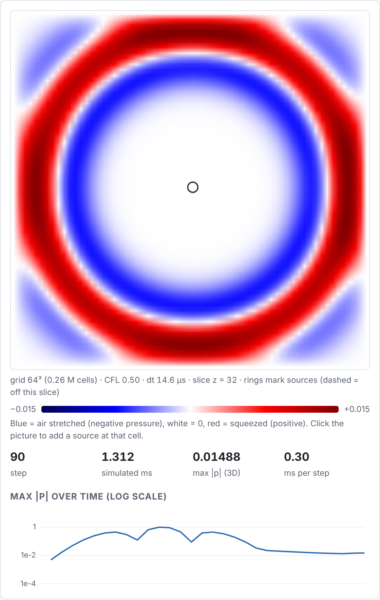

# Wave Sim — ECE 379K

GPU-accelerated 3D wave simulator. See the week plan for the full contract.

| Piece | Owner | Files |
|---|---|---|
| CPU reference, hybrid split, live view | Krish | `include/physics.hpp`, `src/cpu_solver.cpp`, `include/hybrid.hpp`, `src/hybrid_solver.cpp`, `src/gpu_slab.cu`, `src/live_api.cpp`, `tools/test_cpu.cpp`, `tools/test_hybrid.cpp`, `tools/check_cpu.sh`, `tools/run_results.py`, `tools/results.slurm`, `tools/live_gui.*`, `docs/PHYSICS.md`, `docs/CPU.md` |
| Config | Rishik | `include/config.hpp`, `src/config.cpp`, `configs/`, `tools/plot_slice.py` |
| GPU | Connor | `src/gpu_solver.cu` (shares `include/solver.hpp` with Krish) |
| Runner + tests | Venthan | `include/output.hpp`, `src/main.cpp`, `src/output.cpp`, `tools/compare.py`, `tools/bench.sh` |



## Quick start (Linux, WSL or Lonestar6)

```bash
make cpu                                          # build ./wavesim
./wavesim configs/one_source_64.cfg --backend cpu # run one config, writes out/one_source_64/cpu/
make check                                        # CPU + hybrid-split checks, every config
make gui && python3 tools/live_gui.py             # live view at http://localhost:8000
python3 tools/plot_slice.py out/one_source_64/cpu --all   # PNGs + GIF of the saved slices
```

On a Lonestar6 GPU node:

```bash
module load cuda && make gpu
./wavesim configs/bench_128.cfg --backend gpu                    # GPU only
./wavesim configs/bench_128.cfg --backend hybrid --cpu-layers 2  # CPU+GPU split
python3 tools/run_results.py     # all comparisons and timings -> docs/RESULTS.md
```

or from a login node: `mkdir -p out/results && sbatch tools/results.slurm`.

Example configs live in `configs/`: `tiny_33`, `one_source_64`, `two_source_64`,
`bench_128`, `sine_64`, and `bad_cfl` (deliberately rejected).

Status of each piece: [docs/CPU.md](docs/CPU.md) (CPU baseline),
[docs/TESTING.md](docs/TESTING.md) and [docs/RESULTS.md](docs/RESULTS.md) (runner, benchmark).
The CUDA baseline is in `src/gpu_solver.cu`; build it with `make gpu` on a CUDA
machine. [docs/GPU.md](docs/GPU.md) documents Connor's standalone A100 checks,
recorded timings, and the remaining integrated CPU/GPU benchmarks.
`src/gpu_stub.cpp` is used only for CPU-only builds. `tools/plot_slice.py` is a
placeholder for Rishik's version with the same interface.
