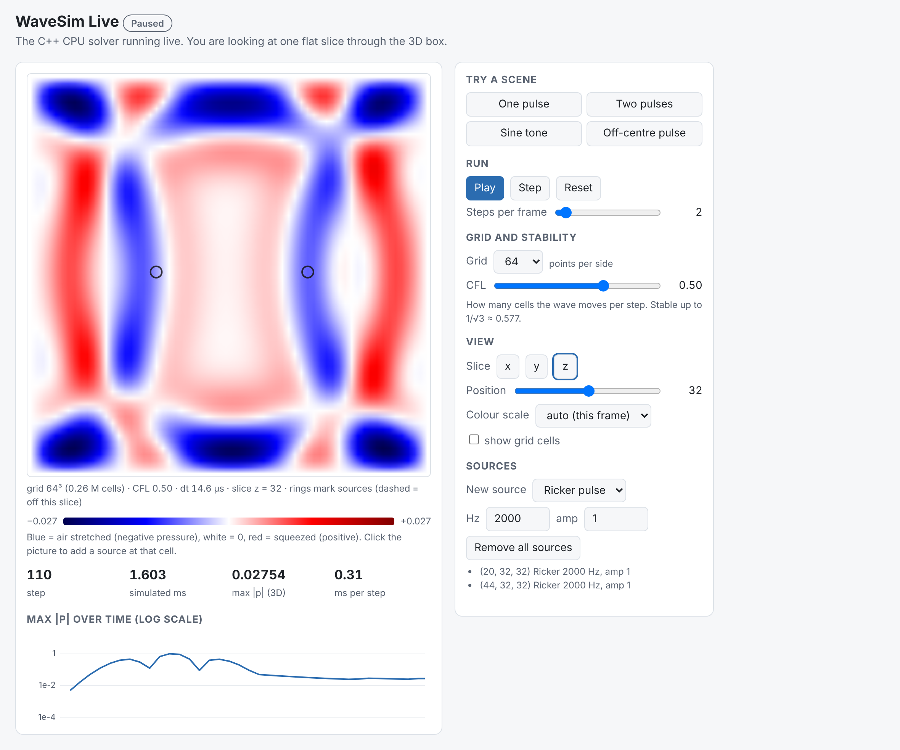
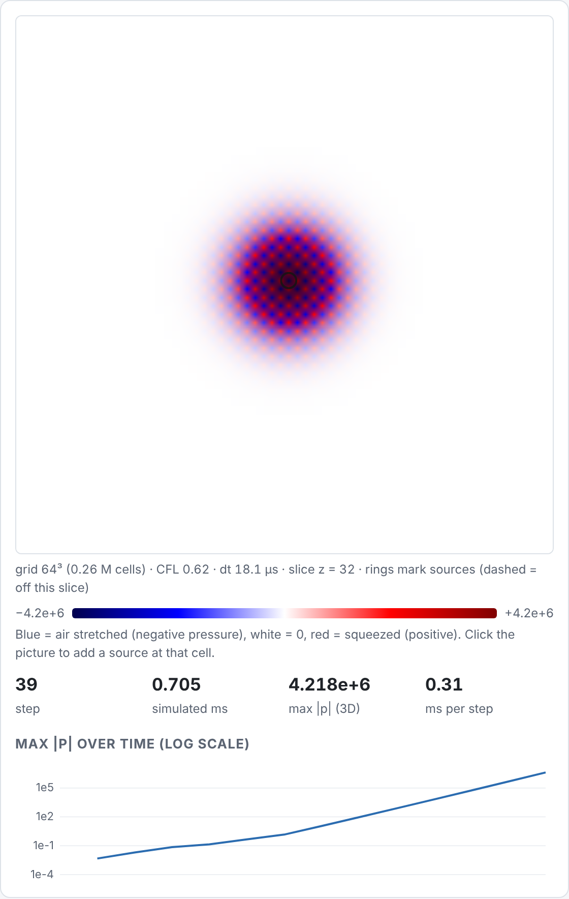

# CPU baseline (owner: Krish)

The CPU solver is the single-core reference implementation. It is the answer
key the GPU is compared against (relative L2 error under 1%) and the one-core
baseline for the 5x speed-up target. The physics is described in
[PHYSICS.md](PHYSICS.md).

## What is in the baseline

| Piece | File | What it does |
|---|---|---|
| Shared math | `include/physics.hpp` | `idx()`, `source_value()`, `update_cell()`; also used by the GPU |
| Solver | `src/cpu_solver.cpp` | One thread, three buffers, the five-part step from the plan |
| Config reader | `src/config.cpp` | Parses and validates `.cfg` files; every error names the line |
| Example configs | `configs/*.cfg` | The four reference cases, `sine_64`, and `bad_cfl` |
| Unit checks | `tools/test_cpu.cpp` | Zero field, symmetry, stability at CFL 0.5, blow-up at 0.6, reference values |
| End-to-end check | `tools/check_cpu.sh` | Runs every config through `./wavesim` and checks the outputs |
| Live view | `src/live_api.cpp`, `tools/live_gui.py`, `tools/live_gui.html` | Watch the solver run in a browser |

`src/config.cpp` follows the format and validation rules in the week plan. If
Rishik's parser replaces it, nothing else needs to change: everything depends
only on `include/config.hpp`.

## Checking it

```bash
make check
```

This runs `./test_cpu --all-refs` and then `tools/check_cpu.sh`. Expected
ending: `ALL CHECKS PASSED (0 failures)` and `CPU BASELINE: ALL CHECKS PASSED`.

Reference values (max |p| after the last step, Ricker 2000 Hz, amplitude 1,
CFL 0.5, dx = 1 cm). All four match to 4 digits when run through `./wavesim`:

| Config | Grid | Steps | Expected | CPU result | CPU total (ms)* |
|---|---|---:|---:|---:|---:|
| `tiny_33` | 33³ | 200 | 0.04977 | 0.0497707 | 7 |
| `one_source_64` | 64³ | 1,000 | 0.02026 | 0.020262 | 307 |
| `two_source_64` | 64³ | 1,000 | 0.03303 | 0.0330257 | 368 |
| `bench_128` | 128³ | 1,000 | 0.02129 | 0.0212878 | 2,675 |

\*Measured on a cloud dev machine (one Xeon core), snapshots excluded. On a
Lonestar6 login node `bench_128` took about 3.1 s. The official baseline is
the number `tools/bench.sh` records on a Lonestar6 GPU compute node, with the
CPU run pinned to one core.

`check_cpu.sh` also confirms that `final.bin` is exactly nx·ny·nz float32
values, that snapshots appear every `snapshot_every` steps, that `compare.py`
passes a run against itself, and that `configs/bad_cfl.cfg` is rejected:

```
error: configs/bad_cfl.cfg:8: cfl must be in (0, 0.577] for a stable 3D simulation (limit 1/sqrt(3)), got 0.7
```

## Config file reference

One `key = value` per line. `#` starts a comment. Unknown keys and repeated
keys are errors, so typos are caught.

| Key | Default | Allowed |
|---|---|---|
| `nx`, `ny`, `nz` | 64 | 8 to 512 |
| `dx` | 0.01 | > 0 (meters) |
| `c` | 343 | > 0 (m/s) |
| `cfl` | 0.5 | 0 < cfl ≤ 0.577 |
| `steps` | 1000 | ≥ 1 |
| `snapshot_every` | 0 | ≥ 0 (0 = no slices) |
| `snapshot_axis` | z | x, y or z |
| `snapshot_index` | -1 | -1 (middle) or 0 to n-1 on that axis |
| `output_dir` | out/default | any path |
| `source` | none | `i j k type freq_hz amplitude`, 1 to 8 lines, i/j/k interior (1 to n-2), type `ricker` or `sine`, freq > 0 |

A source with fewer than 10 grid points per wavelength (c / (freq · dx) < 10)
prints a warning but still runs.

## Live view

```bash
make gui
python3 tools/live_gui.py
```

Then open <http://localhost:8000>. The page shows one slice of the 3D field as
the real C++ solver runs, plus max |p| over time.



You can:

- start a ready-made scene: one pulse, two pulses, a sine tone, an off-centre pulse
- play, pause, single-step and reset
- change the grid size and the CFL number (above 0.577 it blows up, on purpose)
- switch the slice between x, y and z and move it through the box
- click the picture to add a Ricker or sine source at that cell (up to 8);
  rings mark the sources (dashed when the source is off the current slice)
- tick "show grid cells" to see the raw cells instead of the smoothed picture

Pushing CFL above the limit shows the instability: the run stops by itself
when max |p| passes 10⁶, with the checkerboard pattern typical of it.



Screenshots in `docs/img/` were taken at fixed step counts, so they can be
remade the same way.

It needs only `g++`, `make` and Python 3 (standard library). The GUI runs the
same `CpuSolver` through `src/live_api.cpp`, so it computes exactly what
`./wavesim` computes: 1,000 steps of the default setup give max |p| =
0.020262, the `one_source_64` reference.

**On Lonestar6** there is no screen, so forward the port from your laptop
(PowerShell or a terminal):

```bash
ssh -L 8000:localhost:8000 <username>@ls6.tacc.utexas.edu
```

then run the two commands above on Lonestar6 and open <http://localhost:8000>
in your laptop's browser. Keep the grid small on a login node (64³ or less),
or start an interactive compute session first.

**On Windows**, run it inside WSL and open <http://localhost:8000> in your
Windows browser. If the page doesn't load, start it with
`python3 tools/live_gui.py --host 0.0.0.0`.

## Hybrid CPU+GPU split

`--backend hybrid --cpu-layers N` splits one simulation along z: the CPU
updates z-layers 1..N, the GPU updates the rest, and both run at the same
time. Each part keeps a ghost copy of the neighbour's boundary layer, and the
two swap one layer (nx·ny floats each way) after every step. Details and a
picture are in `include/hybrid.hpp`.

- `src/hybrid_solver.cpp`: the CPU slab and the split solver (works with any
  two slabs).
- `src/gpu_slab.cu`: the GPU slab, using the same kernels as Connor's
  `GpuSolver`.
- `tools/test_hybrid.cpp` (`make test-hybrid`, also part of `make check`):
  builds the split from two CPU slabs and requires it to equal `CpuSolver`
  bit for bit, for splits at the first layer, the last layer, through a
  source and on non-cubic grids. Breaking the layer swap makes every case
  fail, so the test does catch mistakes.

The GPU slab needs a CUDA build, so it is checked on Lonestar6:
`tools/run_results.py` compares the hybrid run against the CPU with
`compare.py` and times splits of 1, 2, 4, 8 and 16 CPU layers.

What to expect: one CPU core is roughly 100 times slower per layer than the
A100, so the CPU can only take a few layers before the GPU waits on it, and
the per-step layer swap costs about as much as a whole GPU step at 128³. The
split is therefore expected to be correct but not faster than the GPU alone.
The measured table in [RESULTS.md](RESULTS.md) is what to report.

## Pictures from saved slices

```bash
python3 tools/plot_slice.py out/one_source_64/cpu          # 6-frame strip
python3 tools/plot_slice.py out/one_source_64/cpu --all    # + every frame and wave.gif
```

Output goes to `<run_dir>/plots/`. Every frame uses the same colour range, so
later frames look fainter as the energy spreads through the box.
