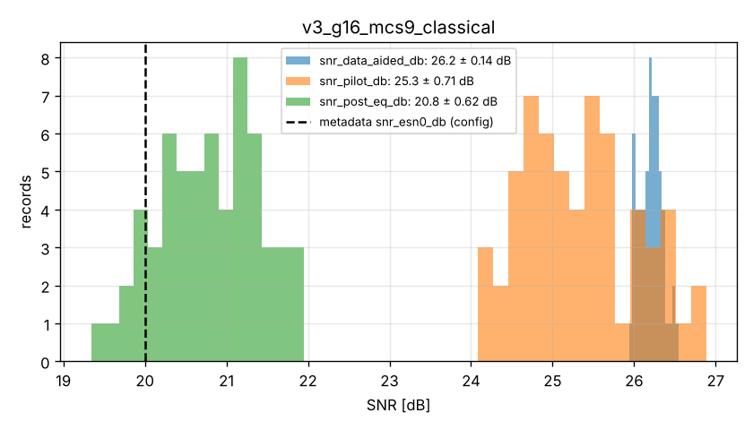

# Operating point — `v3_g16_mcs9_classical`

## 3a. Receiver
**Verdict: classical receiver.**

- `raw-inter-ce-fd-data` present in 60/60 records, non-zero in 60/60 (100 %)
- mean |H| of the interpolated estimate over non-zero REs: 57.6 (fixed-point units)
- metadata `phy_freq_domain_receiver_type`: ['classical_rx'] (consistent with the data)

## 3b. Link quality (per record = one slot)

| estimator | what it measures | mean [dB] | std [dB] | min | max |
|---|---|---|---|---|---|
| `snr_data_aided_db` | channel SNR, known tx symbols + smoothed y/x (genie) | 26.21 | 0.14 | 25.94 | 26.54 |
| `snr_pilot_db` | raw DMRS estimate vs. its smoothed version (blind) | 25.34 | 0.71 | 24.08 | 26.88 |
| `snr_post_eq_db` | after equalizing with the gNB interpolated CE (1/EVM²) | 20.80 | 0.62 | 19.34 | 21.95 |

Metadata cross-check: `snr_esn0_db` = 20.0 dB, channel model `tdl_d`, speed 5.0 m/s, delay spread 50 ns.  These are the *channel-emulator configuration* copied from the recorder config, not measurements.

- Measured channel SNR (26.2 dB) differs from the configured 20.0 dB → the metadata SNR field should not be used as a label until the setup (emulator vs. cabled attenuator) is confirmed.
- The SNR the demapper actually sees with the gNB's classical CE is 20.8 dB, i.e. 5.4 dB of channel-estimation loss.
- Zero coded/payload bit errors are expected at this SNR for QPSK (uncoded BER ≈ Q(√SNR) < 1e-20).

